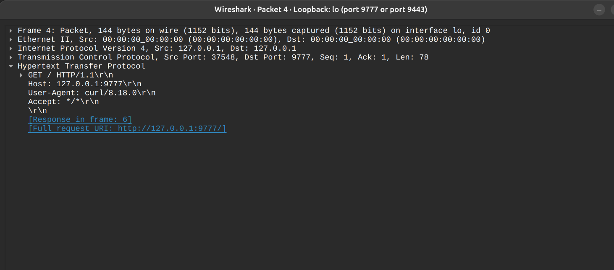
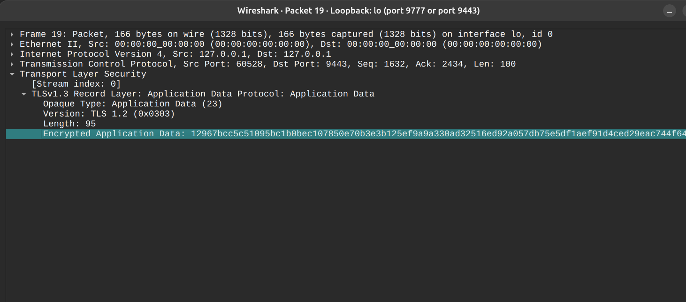

## TLS vs HTTP Plano
Estas imágenes muestran la actuación de TLS sobre la conexión entre el cliente y el Zonal Cache. En la segunda imagen la información que se le envía al Zonal Cache va encriptada.

