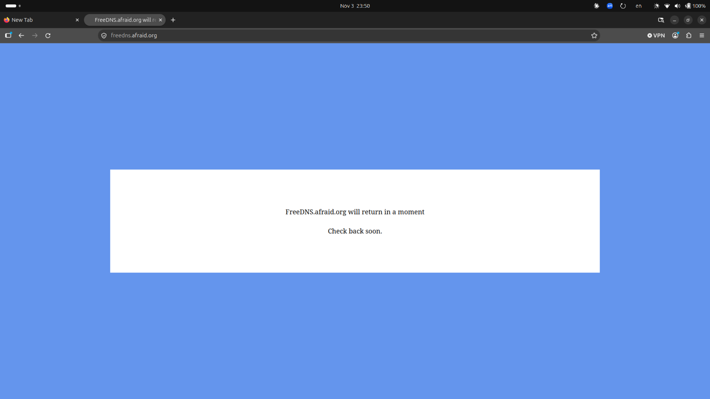

## TLS vs HTTP Plano

## Evidencia
freedns.afraid.org estaba caída en el momento de la grabación. 

Por eso no pude demostrar la validación TXT de un subdominio. Acá adjunto capturas de la validación.

*capturas*