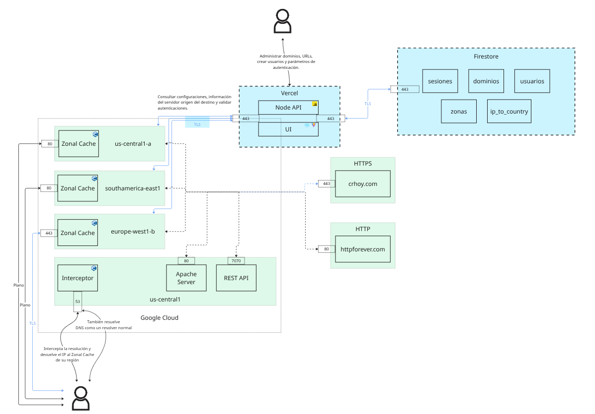

# Proyecto 2 — Red de cachés zonales

**IC-7602 Redes · Instituto Tecnológico de Costa Rica · II Semestre 2026**
Djedrielle Alexander — carné 2024154899
Repositorio: <https://github.com/djedrielle/2026-02-2024154899-IC7602-P2>

---

## Índice

1. [Qué hace este sistema](#1-qué-hace-este-sistema)
2. [Arquitectura](#2-arquitectura)
3. [Requisitos previos](#3-requisitos-previos)
4. [Cómo ejecutarlo en su máquina](#4-cómo-ejecutarlo-en-su-máquina)
5. [Cómo desplegarlo en Google Cloud](#5-cómo-desplegarlo-en-google-cloud)
6. [Pruebas realizadas y cómo reproducirlas](#6-pruebas-realizadas-y-cómo-reproducirlas)
7. [Qué funciona y qué no](#7-qué-funciona-y-qué-no)
8. [Recomendaciones](#8-recomendaciones)
9. [Conclusiones](#9-conclusiones)

---

## 1. Qué hace este sistema

Cuando usted escribe `crhoy.com` en el navegador, lo normal es que su computadora
pregunte «¿dónde está crhoy.com?» y termine hablando con el servidor del
periódico, esté donde esté.

Este sistema se mete en medio de esa conversación. Responde esa pregunta con la
dirección de una **caché zonal** cercana a usted. La caché guarda copias del
contenido, así que la segunda vez que alguien pide la misma página, la entrega
de inmediato sin volver al origen.

Dos ventajas: el contenido viaja menos y el servidor de origen recibe menos
carga.

El sistema tiene cinco partes, y las cinco se ejecutan automatizadas con
Docker, Helm y Terraform.

---

## 2. Arquitectura
### Diagrama Estructural


### Diagrama Flujo

```
                    ┌──────────────────┐
   1. ¿dónde está   │  DNS Interceptor │  mira de qué país viene usted
      crhoy.com? ──▶│   (GNU C, UDP)   │  y responde con la caché más cercana
                    └────────┬─────────┘
                             │ consulta
                             ▼
                    ┌──────────────────┐
                    │ REST API Node.js │  Vercel + Firestore
                    │       + UI       │  dominios, reglas, usuarios, llaves
                    └────────▲─────────┘
                             │ configuración
   2. GET /         ┌────────┴─────────┐
      ────────────▶ │   Zonal Cache    │  ¿está en caché?
                    │  (GNU C, TCP)    │   sí → lo entrega
                    └────────┬─────────┘   no → lo busca y lo guarda
                             │
                 ┌───────────┴───────────┐
                 ▼                       ▼
        ┌─────────────────┐    ┌──────────────────┐
        │  Apache (sitio) │    │ REST API (Java)  │   + sitios externos
        │     origen      │    │  Javalin, origen │     HTTP y HTTPS
        └─────────────────┘    └──────────────────┘
```

| Componente | Lenguaje / tecnología | Dónde corre |
|---|---|---|
| DNS Interceptor | GNU C, UDP puerto 53 | GKE, clúster `origenes` |
| Zonal Cache (×3) | GNU C, TCP, OpenSSL | GKE, un clúster por región |
| REST API + UI | Node.js, React, Vite, Tailwind | Vercel |
| Base de datos | Firestore | Google Cloud |
| REST API de pruebas | Java 17 + Javalin | GKE, clúster `origenes` |
| Servidor de origen | Apache httpd 2.4 | GKE, clúster `origenes` |

### Las cuatro regiones

| Clúster | Zona | Contiene | TLS |
|---|---|---|---|
| `origenes` | `us-central1-a` | interceptor, Apache, API Java | — |
| `cache-cr` | `us-central1-a` | caché de Centroamérica | no, puerto 80 |
| `cache-eu` | `europe-west1-b` | caché de Europa | **sí, puerto 443** |
| `cache-br` | `southamerica-east1-a` | caché de Suramérica | no, puerto 80 |

---

## 3. Requisitos previos

Para la versión local necesita:

| Herramienta | Para qué | Cómo instalarla en Ubuntu |
|---|---|---|
| `gcc`, `make` | compilar los componentes en C | `sudo apt install build-essential` |
| `libssl-dev` | TLS en C | `sudo apt install libssl-dev` |
| Docker | construir las imágenes | `sudo apt install docker.io` |
| Node.js 22 | el API y el UI | <https://nodejs.org> |
| `dig` | probar el DNS | `sudo apt install dnsutils` |
| `curl` | probar la caché | `sudo apt install curl` |

Para la versión en la nube, además:

| Herramienta | Cómo instalarla |
|---|---|
| `gcloud` | <https://cloud.google.com/sdk/docs/install> |
| `kubectl` | `sudo snap install kubectl --classic` |
| `gke-gcloud-auth-plugin` | `gcloud components install gke-gcloud-auth-plugin` |
| `helm` | `sudo snap install helm --classic` |
| `terraform` | `sudo snap install terraform --classic` |

> **Nota:** `gke-gcloud-auth-plugin` se olvida con frecuencia. Sin él, `kubectl`
> no puede autenticarse contra Google Kubernetes Engine y falla con un mensaje
> que no dice qué falta.

---

## 4. Cómo ejecutarlo en su máquina

Esta es la forma más rápida de ver el sistema funcionando. No necesita cuenta
de Google Cloud ni gastar dinero.

### 4.1 Clonar y compilar

```bash
git clone https://github.com/djedrielle/2026-02-2024154899-IC7602-P2.git
cd 2026-02-2024154899-IC7602-P2
make
```

Eso produce dos ejecutables:

```
bin/zonal_cache
bin/interceptor
```

### 4.2 Levantar un servidor de origen

La caché necesita algo que copiar. El Apache del proyecto sirve una página con
HTML, CSS, JavaScript, una imagen y un JSON — justamente para poder demostrar
que cada tipo de archivo recibe un tiempo de vida distinto.

```bash
docker build -f apache/Dockerfile -t apache-origen . && docker run -d --rm --name apache-origen -p 8081:80 apache-origen
```

Compruébelo abriendo <http://127.0.0.1:8081/> en el navegador.

### 4.3 Levantar la caché zonal

La caché lee su configuración del REST API desplegado en Vercel, así que
necesita conexión a internet y el secreto compartido.

```bash
EXTRA_HEADERS=$'x-config-key: ABCDEFG\r\n' CACHE_DIR=./cache ZONAL_PUERTO_IN=9777 CANT_MAX_REGLAS=64 NODE_API_HOST=zonal-cache-rest-api-nodejs.vercel.app NODE_API_PORT=443 NODE_API_TLS=1 ./bin/zonal_cache
```

> **El `$'...'` no es decorativo.** El valor de `EXTRA_HEADERS` tiene que
> terminar en un retorno de carro y un salto de línea (`\r\n`), que es como se
> separan los encabezados HTTP. La forma `$'...'` de bash es la que los
> interpreta; con comillas normales viajarían las letras `\` y `n` literales y
> la petición saldría mal formada.

Si arranca bien verá:

```
Zonal Cache escuchando en el puerto 9777
Escuchando conexiones...
```

### 4.4 Pedirle algo

En otra terminal:

```bash
curl -i -H "Host: crhoy.com" http://127.0.0.1:9777/
```

La primera vez tarda un par de segundos: la caché va al origen. La segunda es
inmediata, y en la terminal de la caché aparece:

```
Recurso retornado desde cache.
```

### 4.5 Levantar el REST API y el UI

```bash
cd rest_api_NodeJS && npm install && npm run dev
```

Abra <http://localhost:5173/>. Desde ahí puede registrarse, dar de alta un
dominio, configurar reglas por URL y generar llaves de acceso.

### 4.6 El API REST en Java

```bash
docker build -f rest_api_Java/Dockerfile -t rest-api-java . && docker run -d --rm -p 7070:7070 rest-api-java
```

```bash
curl http://127.0.0.1:7070/noticias
```

---

### 4.7 Todo de una vez con Docker Compose

En vez de levantar cada componente a mano, `docker-compose.yml` arranca los
cuatro juntos: Apache, el API de Java, la cache zonal y el DNS Interceptor.

```bash
cp .env.ejemplo .env
```

Revise el archivo `.env`. Si alguno de los puertos ya esta ocupado en su
maquina, cambielo ahi mismo.

```bash
docker compose up --build
```

Al terminar vera los cuatro servicios en marcha:

```
apache           Up (healthy)
dns-interceptor  Up
rest-api-java    Up (healthy)
zonal-cache      Up
```

Pruebe cada uno:

```bash
curl -s -o /dev/null -w 'apache: %{http_code}\n' http://127.0.0.1:8081/ && curl -s http://127.0.0.1:7070/noticias | head -c 80 && echo && dig @127.0.0.1 -p 5300 crhoy.com +short
```

Y la cache, dos veces seguidas para ver la diferencia:

```bash
curl -s -o /dev/null -w '1a: %{time_total}s\n' -H "Host: crhoy.com" http://127.0.0.1:9777/tecnologia/ && curl -s -o /dev/null -w '2a: %{time_total}s\n' -H "Host: crhoy.com" http://127.0.0.1:9777/tecnologia/
```

Resultado obtenido en la prueba:

```
1a: 2.023021s     <- fue al origen
2a: 0.002489s     <- desde cache
```

Para apagarlo todo:

```bash
docker compose down
```

Si ademas quiere borrar el contenido que la cache guardo:

```bash
docker compose down -v
```

> **Sobre los origenes.** Dentro de Compose los cuatro servicios comparten una
> red y se ven por su NOMBRE. Si quiere que la cache use el Apache de este mismo
> compose como origen, registre en la interfaz web un dominio cuyo `origen_host`
> sea `apache` y cuyo puerto sea `80`. En el despliegue de Kubernetes esto no es
> posible, porque cada componente vive en un cluster distinto y hace falta una
> direccion IP publica.

---

## 5. Cómo desplegarlo en Google Cloud

### 5.1 Crear la infraestructura con Terraform

Terraform crea los cuatro clústeres, el registro de imágenes y las direcciones
IP públicas. **No crea las aplicaciones**: eso es trabajo de Helm.

```bash
gcloud auth application-default login
```

> Esto es distinto de `gcloud auth login`. Terraform no usa la credencial de la
> línea de comandos sino un archivo aparte llamado *Application Default
> Credentials*. Si lo omite, el despliegue falla con «could not find default
> credentials», que suena a problema de permisos y no lo es.

```bash
cd terraform && cp terraform.tfvars.ejemplo terraform.tfvars
```

Edite `terraform.tfvars` y ponga el identificador de su proyecto de Google
Cloud. Después:

```bash
cd terraform && terraform init && terraform plan
```

Lea el plan. Al final dice cuántos recursos va a crear; deberían ser alrededor
de veinte. Si todo se ve bien:

```bash
cd terraform && terraform apply
```

Tarda entre cinco y diez minutos. Al terminar imprime las direcciones:

```
ip_interceptor   = "34.16.30.93"
ip_apache        = "136.111.140.104"
ip_rest_api_java = "35.253.162.152"
ips_caches       = { "br" = "34.95.138.204", "cr" = "34.122.172.37", "eu" = "34.53.129.191" }
registro         = "us-central1-docker.pkg.dev/zonal-cache/redes"
```

Anótelas: las va a necesitar en los pasos siguientes.

### 5.2 Construir y subir las imágenes

```bash
gcloud auth configure-docker us-central1-docker.pkg.dev
```

```bash
R=us-central1-docker.pkg.dev/zonal-cache/redes && for par in "apache/Dockerfile:apache-origen" "rest_api_Java/Dockerfile:rest-api-java" "interceptor/Dockerfile:dns-interceptor" "zonal_cache/Dockerfile:zonal-cache"; do docker build -f "${par%%:*}" -t "$R/${par##*:}:1.0.0" . && docker push "$R/${par##*:}:1.0.0"; done
```

### 5.3 Desplegar el clúster de orígenes

```bash
gcloud container clusters get-credentials origenes --zone=us-central1-a --project=zonal-cache
```

```bash
helm install apache ./helm/apache --set servicio.ipEstatica=136.111.140.104
```

```bash
helm install java ./helm/rest-api-java --set servicio.ipEstatica=35.253.162.152
```

```bash
helm install dns ./helm/interceptor --set servicio.ipEstatica=34.16.30.93
```

### 5.4 Desplegar cada caché

Cada caché va en **su propio clúster**. Antes del chart hay que crear el
secreto compartido con el API:

```bash
gcloud container clusters get-credentials cache-cr --zone=us-central1-a --project=zonal-cache
```

```bash
printf 'x-config-key: %s\r\n' "ABCDEFG" | kubectl create secret generic zonal-cache-config --from-file=extra-headers=/dev/stdin
```

> **Por qué `printf` canalizado y no una variable.** La sustitución `$(...)` de
> bash **elimina los saltos de línea finales**, de modo que el `\n` del
> encabezado se perdería y la caché recibiría una respuesta vacía del API. Este
> error cuesta mucho de encontrar porque el mensaje no apunta a la causa.

```bash
helm install cache-cr ./helm/zonal-cache -f helm/zonal-cache/valores-cr.yaml --set servicio.ipEstatica=34.122.172.37
```

Repita para `cache-br` y `cache-eu` cambiando el contexto, el archivo de
valores y la dirección IP.

**`cache-eu` necesita además un certificado**, porque es la única con
terminación TLS:

```bash
openssl req -x509 -newkey rsa:2048 -nodes -keyout clave.pem -out cert.pem -days 365 -subj "/CN=demo.zonal.cr"
```

```bash
kubectl --context=gke_zonal-cache_europe-west1-b_cache-eu create secret tls zonal-cache-tls --cert=cert.pem --key=clave.pem
```

### 5.5 Cargar las direcciones en Firestore

El interceptor decide a qué caché mandar a cada persona consultando la
colección `zonas` de Firestore. Hay que escribir ahí las direcciones reales,
un documento por código de país:

| Documento | Campo `ip_cache` | Campo `region` |
|---|---|---|
| `CR` | la IP de `cache-cr` | `us-central1` |
| `ES` | la IP de `cache-eu` | `europe-west1` |
| `BR` | la IP de `cache-br` | `southamerica-east1` |

**Mientras no se haga este paso, nada del despliegue se nota desde el
cliente**: el interceptor sigue devolviendo lo que hubiera antes.

### 5.6 Apagar todo cuando termine

Los cuatro clústeres cuestan alrededor de **$0.40 por hora** solo en tarifas de
administración, más las máquinas y los balanceadores.

```bash
cd terraform && terraform destroy
```

Volver a crearlos toma menos de diez minutos, así que no tiene sentido dejarlos
encendidos entre sesiones de trabajo.

---

## 6. Pruebas realizadas y cómo reproducirlas

### 6.1 El DNS Interceptor responde según el país

**Qué se prueba:** que una consulta DNS devuelve la dirección de la caché que
corresponde al país de quien pregunta.

```bash
dig @34.16.30.93 crhoy.com +short
```

**Resultado obtenido:**

```
34.122.172.37
```

Y en la bitácora del interceptor:

```
respuesta API: {"ip":"186.176.168.69","pais":"CR","ip_cache":"34.122.172.37"}
Codigo pais: CR
```

Reconoció la dirección pública como costarricense y devolvió la caché de
Centroamérica.

### 6.2 Los dominios ajenos se reenvían

**Qué se prueba:** que el interceptor puede usarse como servidor DNS del
sistema sin romper el resto de internet.

```bash
dig @34.16.30.93 github.com +short
```

**Resultado:** `140.82.112.3` — la dirección real de GitHub, obtenida
reenviando la consulta a `8.8.8.8`.

Para usarlo como resolvedor del sistema, pero **solo** para los dominios del
proyecto:

```bash
sudo resolvectl dns wlp1s0 34.16.30.93 && sudo resolvectl domain wlp1s0 crhoy.com api.demo.cr sitio.demo.cr httpforever.com
```

Para volver atrás: `sudo resolvectl revert wlp1s0`.

### 6.3 Acierto y fallo de caché

```bash
curl -s -o /dev/null -w 'primera: %{time_total}s\n' -H "Host: crhoy.com" http://34.122.172.37/ && curl -s -o /dev/null -w 'segunda: %{time_total}s\n' -H "Host: crhoy.com" http://34.122.172.37/
```

**Resultado:**

```
primera: 2.266079s
segunda: 0.993574s
```

La segunda no va al origen. En la bitácora de la caché aparece
`Recurso retornado desde cache.`

### 6.4 Configuración distinta por URL en el mismo dominio

**Qué se prueba:** que dos rutas del mismo dominio reciben tiempos de vida y
políticas de reemplazo diferentes.

El dominio `crhoy.com` tiene tres reglas, que se evalúan de más a menos
específica:

| Patrón | Tipo | TTL | Algoritmo |
|---|---|---|---|
| `/tecnologia/*` | html | 30 s | MRU |
| `/tecnologia/*` | png, jpg | 604800 s | LFU |
| `/deportes/*` | html | 900 s | FIFO |
| `/*` | html | 300 s | LRU |

```bash
curl -s -o /dev/null -H "Host: crhoy.com" http://34.122.172.37/tecnologia/ && curl -s -o /dev/null -H "Host: crhoy.com" http://34.122.172.37/deportes/
```

Después, dentro del contenedor, cada recurso guardado tiene su archivo `.meta`
con el identificador de la regla que se le aplicó y su momento de expiración.
En las pruebas locales se comprobó:

```
prueba-reglas.com/pagina.html        regla=QOGYX3APNdUV9fG19nbU   TTL=300 s
prueba-reglas.com/imagenes/foto.png  regla=JSmAokX7kaqJefBC0Rwe   TTL=86400 s
```

Dos rutas del mismo dominio, dos reglas, dos tiempos de vida.

### 6.5 Autenticación por llave de API

**Qué se prueba:** que una ruta protegida exige el encabezado `x-api-key`.

```bash
curl -s -o /dev/null -w 'sin llave: %{http_code}\n' -H "Host: sitio.demo.cr" http://34.122.172.37/
```

```bash
curl -s -o /dev/null -w 'con llave: %{http_code}\n' -H "Host: sitio.demo.cr" -H "x-api-key: SU_LLAVE" http://34.122.172.37/
```

**Resultados obtenidos en las pruebas:**

```
  llave correcta                 -> HTTP 200
  llave + un caracter de mas     -> HTTP 401
  prefijo de la llave            -> HTTP 401
  llave ajena                    -> HTTP 401
  sin encabezado                 -> HTTP 302   (redirige al formulario)
  dominio sin llaves, cualquiera -> HTTP 401
```

Los dos primeros casos son los importantes: una comparación descuidada
aceptaría una llave con caracteres de más, y una llave vacía almacenada dejaría
pasar a cualquiera.

### 6.6 Autenticación por usuario y contraseña

**Qué se prueba:** el circuito completo de sesión.

1. Pida una ruta protegida sin credencial:

   ```bash
   curl -i -H "Host: api.demo.cr" http://34.122.172.37/noticias/1
   ```

   Responde **302** con un encabezado `Location` que apunta al formulario:

   ```
   Location: https://zonal-cache-rest-api-nodejs.vercel.app:443/login?redirect=http://api.demo.cr/noticias/1
   ```

2. Abra esa dirección en el navegador e inicie sesión.

3. El UI lo devuelve a la ruta original con el token pegado:

   ```
   http://api.demo.cr/noticias/1?session=526946898a4736...
   ```

4. La caché valida ese token contra el API y entrega el contenido.

### 6.7 Terminación TLS

**Qué se prueba:** que la caché de Europa cifra la conexión con el cliente.

```bash
curl -k -I -H "Host: crhoy.com" https://34.53.129.191/
```

Responde `HTTP/1.1 200 OK`. El `-k` es necesario porque el certificado es
autofirmado.

La captura con Wireshark muestra la diferencia. En HTTP plano se lee la
petición completa:


Con TLS, el mismo intercambio viaja como *Application Data* y no se puede leer:


### 6.8 Origen externo por HTTPS

```bash
curl -s -o /dev/null -w '%{http_code}\n' -H "Host: crhoy.com" http://34.122.172.37/
```

`crhoy.com` está configurado con `tls: true` y puerto 443, así que la caché
abre una conexión cifrada hacia el origen, verifica su certificado contra el
almacén del sistema y guarda el resultado.

### 6.9 Origen externo por HTTP plano

```bash
curl -s -o /dev/null -w '%{http_code}\n' -H "Host: httpforever.com" http://34.122.172.37/
```

`httpforever.com` existe precisamente para no migrar nunca a HTTPS, así que
sirve como origen en texto plano de forma estable.

### 6.10 Peticiones partidas en varios segmentos

**Qué se prueba:** que la caché arma correctamente una petición que llega en
varios pedazos, porque TCP es un flujo y no respeta los límites de mensaje.

Se envió la misma petición partida en dos y en tres segmentos, y sin encabezado
`Host`. En los tres casos la caché respondió correctamente y no se cayó.

### 6.11 Varias conexiones simultáneas

**Qué se prueba:** que la caché atiende a varios clientes a la vez.

```bash
for i in 1 2 3 4 5 6; do curl -s -o /dev/null -m 30 -w "conexion $i -> %{time_total}s\n" http://34.122.172.37/ & done; wait
```

**Antes de implementar `fork()`** las seis se encolaban:

```
2.1s → 5.7s → 8.4s → 11.3s → 12.8s → 13.0s
```

**Después**, se reparten el ancho de banda en vez de esperarse:

```
2.3s → 5.3s → 6.8s → 8.4s → 9.0s → 9.1s
```

El rendimiento agregado pasó de 288 KB/s a 413 KB/s.

### 6.12 Una conexión ociosa no bloquea la caché

**Qué se prueba:** que un cliente que abre una conexión y no manda nada —algo
que los navegadores hacen de forma rutinaria— no deja fuera de servicio a los
demás.

```bash
(exec 3<>/dev/tcp/34.122.172.37/80; sleep 20; exec 3<&-) & sleep 1; curl -s -o /dev/null -m 20 -w 'con una ociosa abierta -> %{http_code} %{time_total}s\n' http://34.122.172.37/
```

**Antes:** tiempo agotado, la caché quedaba bloqueada indefinidamente.
**Después:** `HTTP 200 en 1.75 s`.

### 6.13 El REST API en Java

```bash
curl -s http://35.253.162.152:7070/noticias
```

Los cuatro verbos:

```bash
curl -i -X POST http://35.253.162.152:7070/noticias -H 'Content-Type: application/json' -d '{"titulo":"Prueba","cuerpo":"Contenido de prueba","autor":"Yo"}'
```

```bash
curl -i -X PUT http://35.253.162.152:7070/noticias/1 -H 'Content-Type: application/json' -d '{"titulo":"Corregido","cuerpo":"Nuevo contenido"}'
```

```bash
curl -i -X DELETE http://35.253.162.152:7070/noticias/1
```

Siete pruebas automatizadas acompañan al código:

```bash
cd rest_api_Java && mvn test
```

Comprueban que los identificadores no se reutilizan, que una actualización
conserva la fecha de creación, y que borrar dos veces solo tiene efecto la
primera.

### 6.14 Registro de dominio y verificación por TXT

1. Entre a <https://zonal-cache-rest-api-nodejs.vercel.app/registro> y cree una
   cuenta.
2. Agregue un dominio. El sistema le muestra un valor que debe publicar como
   registro **TXT** en su proveedor de DNS.
3. Publíquelo y compruébelo:

   ```bash
   dig +short TXT sudominio.com @8.8.8.8
   ```

4. Pulse «Verificar ahora» en la interfaz.

Se probó contra un subdominio real registrado en FreeDNS
(`djdrll.privatedns.org`) y la verificación funcionó.

---

## 7. Qué funciona y qué no

La columna **Estado** usa tres valores: **Sí** (funciona por completo),
**Parcial** (funciona con una limitación que conviene conocer) y **No** (no está
implementado).

### 7.1 DNS Interceptor

| Aspecto | Estado | Observaciones |
|---|---|---|
| Responder consultas DNS tipo A | **Sí** | |
| Geolocalizar al cliente por su IP | **Sí** | requiere `externalTrafficPolicy: Local`, ya configurado en el chart |
| Devolver la caché del país | **Sí** | |
| Reenviar dominios ajenos a un DNS real | **Sí** | configurable con `DOMINIOS_PROPIOS` |
| Tiempo de espera en el reenvío | **Sí** | 2 segundos; un DNS externo caído no bloquea el proceso |
| Ejecución automatizada | **Sí** | Dockerfile, chart de Helm y Docker Compose |
| Comodín para países sin caché | **Parcial** | el documento `zonas/ZZ` existe, pero la búsqueda es por identificador exacto: un país sin documento propio no resuelve |
| Registros distintos de A | **Parcial** | los dominios propios solo responden A; los ajenos sí funcionan, porque se reenvían sin interpretar |
| Atender varias consultas a la vez | **No** | es de un solo proceso; una consulta lenta retrasa las siguientes |
| Sondas de salud en Kubernetes | **No** | Kubernetes no sabe sondear UDP; se documenta como decisión, no como olvido |

### 7.2 Zonal Cache

| Aspecto | Estado | Observaciones |
|---|---|---|
| Guardar y servir desde caché | **Sí** | archivos `.dat` y `.meta` en disco |
| Respetar el tiempo de vida | **Sí** | por tipo de archivo |
| Cinco algoritmos de reemplazo | **Sí** | LRU, LFU, FIFO, MRU y RANDOM, los cinco verificados |
| Configuración por URL con comodines | **Sí** | gana la regla con más caracteres literales |
| Presupuesto de caché por regla | **Sí** | cada regla desaloja dentro de su propio espacio |
| Autenticación por `x-api-key` | **Sí** | admite varias llaves por dominio |
| Autenticación por usuario y contraseña | **Sí** | redirige al formulario y valida la sesión contra el API |
| Terminación TLS del lado servidor | **Sí** | verificado con Wireshark |
| Origen por HTTPS con verificación | **Sí** | valida el certificado del origen contra el almacén del sistema |
| Escrituras parciales | **Sí** | reintenta hasta completar la respuesta |
| Peticiones partidas en varios segmentos | **Sí** | probado con dos y tres segmentos |
| Varias conexiones simultáneas | **Sí** | un proceso hijo por conexión |
| Conexiones ociosas | **Sí** | se cierran a los 10 segundos y no bloquean a nadie |
| Ejecución automatizada | **Sí** | Dockerfile, chart con tres archivos de valores y Docker Compose |
| Sondas de salud | **Parcial** | solo la de arranque, y únicamente cuando TLS está desactivado |
| Escrituras simultáneas del mismo recurso | **Parcial** | dos procesos pueden escribir el mismo archivo a la vez; falta escribir a temporal y renombrar |
| Caché persistente entre reinicios | **Parcial** | hay soporte para volumen persistente, pero por omisión se usa almacenamiento efímero |
| `MAX_TAM_ENTRADA` mayor que 65535 | **No** | la validación de enteros aplica el rango de un número de puerto a todos los valores |
| Varias peticiones por conexión | **No** | una petición por conexión; siempre cierra al responder |

### 7.3 REST API Node.js / UI

| Aspecto | Estado | Observaciones |
|---|---|---|
| Registro de usuarios | **Sí** | contraseñas con `scrypt` y sal |
| Inicio y cierre de sesión | **Sí** | |
| Alta y baja de dominios | **Sí** | al borrar elimina también sus reglas y llaves |
| Verificación de propiedad por TXT | **Sí** | probado contra un dominio real en FreeDNS |
| CRUD de reglas por URL | **Sí** | con comodines y configuración por tipo de archivo |
| Crear y eliminar llaves de API | **Sí** | |
| Configuración para la caché | **Sí** | `/api/config`, protegido por secreto compartido |
| Validación de sesiones | **Sí** | con recuperación automática si la sesión quedó desactualizada |
| Resolución de país y caché | **Sí** | `/api/resolver/:ip` |
| Despliegue automático desde GitHub | **Sí** | Vercel |
| Rutas directas del UI | **Sí** | requiere `vercel.json` con reglas de reescritura |
| Estilos | **Sí** | Tailwind CSS v4 |
| Editar la configuración de un dominio | **No** | el endpoint `PUT` existe, pero falta el formulario en la interfaz |
| Eliminar usuarios | **No** | no hay endpoint |
| Modificar contraseñas | **No** | el enunciado lo pide y no está implementado |
| Cantidad de funciones en Vercel | **Parcial** | 12 de 12 permitidas en el plan gratuito; un endpoint más rompe el despliegue |

### 7.4 REST API (Java) / Apache Server

| Aspecto | Estado | Observaciones |
|---|---|---|
| Los cuatro verbos HTTP | **Sí** | GET, POST, PUT y DELETE |
| Códigos de estado correctos | **Sí** | 200, 201 con `Location`, 204, 400 y 404 |
| Validación de entrada | **Sí** | informa todos los problemas a la vez, no de a uno |
| Sonda de salud | **Sí** | `/salud`, separada del recurso real |
| Pruebas automatizadas | **Sí** | siete, con JUnit 5 |
| Ejecución automatizada | **Sí** | Dockerfile de dos etapas, chart y Docker Compose |
| Apache sirviendo un sitio | **Sí** | HTML, CSS, JavaScript, PNG y JSON |
| Persistencia del API en Java | **No** | todo en memoria; se pierde al reiniciar el proceso |
| Varias réplicas del API en Java | **No** | cada réplica tendría sus propios datos, sin estado compartido |
| Diagnóstico en la página del Apache | **Parcial** | consulta un encabezado `X-Cache` que la caché no emite; la página lo maneja sin romperse |

### 7.5 Automatización

| Aspecto | Estado | Observaciones |
|---|---|---|
| Dockerfiles | **Sí** | los cuatro, con construcción en dos etapas |
| Helm Charts | **Sí** | los cuatro, validados con `helm lint` y `kubeconform` |
| Docker Compose | **Sí** | los cuatro componentes en una sola orden, con sondas de salud y puertos configurables |
| Terraform | **Sí** | clústeres, registro de imágenes, direcciones IP y reglas de firewall |
| Despliegue del API y el UI | **Sí** | automático desde GitHub hacia Vercel |

---

## 8. Recomendaciones

1. **Si lo va a implementar en Cloud Provider destruya la infraestructura entre sesiones de trabajo.** Cuatro clústeres
   cuestan alrededor de $0.40 por hora solo en administración. Con
   `terraform destroy` y `terraform apply` el ciclo completo toma menos de diez
   minutos y el gasto baja de cientos de dólares al mes a unos pocos por sesión.

2. **Use clústeres zonales, no regionales.** Un clúster regional replica los
   nodos en tres zonas: usted pide una máquina y le cobran tres. Además, el
   crédito gratuito mensual de Kubernetes solo cubre clústeres zonales.

3. **Dimensione las máquinas contando lo que el sistema reserva para sí.** En un
   nodo de 2 GB, Kubernetes deja 1.36 GB disponibles y sus propios componentes
   consumen 1.2 GB. Quedan 67 MB para sus aplicaciones. Una máquina virtual de
   Java no cabe ahí.

4. **Verifique siempre a qué clúster le está hablando.** `kubectl` y `helm`
   usan un contexto global; es fácil desplegar al clúster equivocado sin darse
   cuenta. Use `--kube-context` explícito en cada comando, o agregue
   `&& kubectl config current-context` para que le confirme dónde está parado.

5. **No calcule a mano el tamaño de los búferes de texto.** Pida a `snprintf`
   el valor que devuelve y compárelo contra el tamaño reservado: si es mayor o
   igual, hubo truncamiento. Un búfer nueve bytes más corto de lo necesario
   produjo en este proyecto un error de autenticación que parecía un problema
   de sesiones.

6. **Desconfíe de las sondas de salud en servicios que no hablan HTTP.** Una
   sonda de tipo TCP contra un puerto con TLS abre la conexión y la cierra sin
   completar el saludo, lo que puede bloquear al proceso que viene a vigilar.
   Si no hay forma de sondear correctamente, es preferible no sondear.

7. **Ponga un tiempo de espera a toda lectura de red.** Una conexión que se
   abre y no envía nada es un comportamiento normal de los navegadores, no una
   anomalía. Sin tiempo de espera, deja el servidor bloqueado para siempre.

8. **Separe la sonda de salud del recurso real.** Si la sonda pide el mismo
   contenido que sirve la aplicación, un dato vacío o un error de datos hace que
   el orquestador reinicie un proceso que está perfectamente sano.

9. **Pruebe los orígenes externos desde donde van a ejecutarse.** Un sitio que
   responde desde su casa puede no ser alcanzable desde un centro de datos de
   Google. En este proyecto, `neverssl.com` funcionaba localmente y no desde
   Google Cloud, lo que llevó a diagnosticar mal la caché.

10. **Limite el alcance cuando cambie el servidor DNS del sistema.** Apuntar
    todo el tráfico a un servidor propio deja la máquina sin internet si ese
    servidor falla. Es más seguro declarar solo los dominios del proyecto y
    dejar el resto al proveedor.

11. **Use una etiqueta de versión nueva en cada imagen.** Si reutiliza la misma
    etiqueta, los nodos que ya la descargaron siguen ejecutando la versión
    anterior y los cambios parecen no tener efecto.

12. **No guarde secretos en archivos de configuración versionados.** Los
    certificados, las contraseñas y los secretos compartidos van como objetos
    `Secret` de Kubernetes, montados en tiempo de ejecución.

13. **Haga una consulta por colección, no una por documento.** Reemplazar un
    ciclo de consultas por una consulta de grupo bajó el tiempo de respuesta de
    la configuración de 550 a 210 milisegundos, y lo volvió constante respecto a
    la cantidad de dominios.

14. **Valide los manifiestos antes de instalarlos.** `helm lint` solo revisa la
    forma del paquete; `kubeconform` los valida contra el esquema real de
    Kubernetes y detecta campos mal escritos que de otro modo se descubren con
    el servicio ya desplegado.

15. **Escriba en la documentación los comandos exactos, no descripciones.** La
    diferencia entre `$'x-config-key: ABC\r\n'` y `"x-config-key: ABC\r\n"` es
    invisible al leer y rompe el sistema al ejecutar.

---

## 9. Conclusiones

1. **La infraestructura como código paga desde el primer día.** Poder destruir
   y recrear cuatro clústeres en diez minutos cambió la forma de trabajar:
   permitió experimentar sin miedo y mantener el gasto bajo control.

2. **La caché zonal cumple su propósito y se puede medir.** La primera petición
   de un recurso tarda 2.27 segundos y la segunda 0.99. La diferencia es
   exactamente el viaje al origen que la caché evita.

3. **La configuración por URL es lo que distingue una caché útil de una
   trivial.** Un mismo dominio puede guardar su página principal 300 segundos y
   sus imágenes una semana. Aplicar un solo criterio a todo el sitio
   desperdiciaría la mayor parte del beneficio.

4. **Un servidor de un solo proceso no sirve para clientes reales.** La caché
   funcionaba perfectamente con `curl` y fallaba con un navegador. La causa no
   era un error de código sino el modelo de concurrencia: un navegador abre
   varias conexiones a la vez y el servidor las atendía en fila.

5. **La latencia esconde los defectos de diseño.** Ese mismo problema era
   invisible en pruebas locales, donde cada petición tardaba milisegundos. Solo
   apareció en la nube, con dos segundos por petición. Probar únicamente en
   local da una falsa sensación de que todo está bien.

6. **Los errores más costosos de encontrar son los que no producen ningún
   error.** Un búfer nueve bytes corto hizo que `snprintf` truncara en silencio;
   el API respondió correctamente a una pregunta mal formada y la caché
   interpretó bien esa respuesta. Cada pieza se comportó como debía y el
   resultado igual estuvo mal.

7. **Las herramientas de monitoreo pueden ser la causa de la falla.** Las
   sondas de Kubernetes, pensadas para detectar procesos muertos, estaban
   matando la caché: abrían conexiones que el servidor no podía atender y el
   orquestador concluía que había muerto.

8. **La frontera entre Terraform y Helm tiene que ser explícita.** Terraform
   crea lo que existe en el proveedor de nube; Helm, lo que corre dentro del
   clúster. Confundirlas lleva a recursos duplicados y a estados que ninguna de
   las dos herramientas reconoce como propios.

9. **Las abstracciones de red filtran información.** Que el pod viera una
   dirección interna en lugar de la IP real del cliente rompió por completo la
   geolocalización, y la causa estaba en una política del balanceador de carga,
   tres capas por debajo del código.

10. **La separación entre configuración y código funciona.** Toda la política de
    caché —dominios, reglas, tiempos de vida, autenticación— vive en Firestore y
    se administra desde una interfaz web. Cambiarla no requiere recompilar ni
    redesplegar: basta con reiniciar el proceso.

11. **Centralizar la configuración tiene un costo que hay que reconocer.** La
    caché lee su configuración una sola vez al arrancar. Eso la hace rápida y
    predecible, pero significa que todo cambio exige un reinicio, con la pérdida
    del contenido ya almacenado.

12. **TLS es sencillo de activar y difícil de operar.** Habilitar la terminación
    cifrada tomó pocas líneas de OpenSSL, pero obligó a reconsiderar las sondas
    de salud, el puerto del servicio, el certificado como objeto de Kubernetes y
    el esquema de las redirecciones.

13. **El trabajo de integración supera al de implementación.** Los componentes
    individuales funcionaron relativamente pronto; la mayor parte del esfuerzo
    se fue en lo que ocurre entre ellos: encabezados mal terminados, direcciones
    reescritas, esquemas ausentes y contextos equivocados.

14. **Documentar los comandos exactos no es burocracia.** Varios de los
    problemas más difíciles de este proyecto se originaron en detalles
    invisibles al leer: un salto de línea que bash eliminaba, una variable de
    entorno nunca definida, un marcador que quedó sin sustituir.

15. **Queda trabajo pendiente y conviene decirlo.** Faltan la gestión de
    contraseñas desde la interfaz, el formulario para editar la configuración de
    un dominio y la escritura atómica de los archivos de caché. Reconocerlo es
    más útil que presentar un inventario de funcionalidades sin matices.
